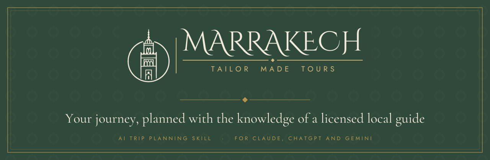

<p align="center">
  
</p>

<p align="center">
  <a href="LICENSE"></a>
  
  
  
  
</p>

<p align="center">
  <strong>Local knowledge, not travel blog advice.</strong> A free AI skill that plans your Marrakech trip<br/>
  the way a licensed guide with 11+ years in Moroccan tour operations would.
</p>

<p align="center">
  Works in Claude, Claude Code, the Claude API, ChatGPT, Gemini and any AI that supports the skill format.
</p>

---

## Why this skill

Ask any AI to plan Marrakech and you usually get the same problems. This skill fixes them.

| A generic AI plan | This skill |
|---|---|
| Packs 6 sights into one day | Two main sights a day, with rest built in |
| Zigzags you across the medina | Groups every day by area |
| Ignores 40°C summer afternoons | Mornings for walking, afternoons for shade |
| Forgets Ramadan and Friday prayers | Plans around the real rhythm of the city |
| Repeats old or made up prices | Fair price ranges with a "last checked" date |
| Says "beware of scams" | Names the real scams and how to say no |
| One plan, no backup | A Plan B for every day |
| Turns Merzouga into a day trip | Honest drive times for every trip |

---

## Quick Start

### Claude (web, desktop and mobile)

1. Download [`release/marrakech-tailor-made-tours.zip`](release/marrakech-tailor-made-tours.zip)
2. In Claude, open **Settings** and find **Skills**
3. Upload the zip and switch the skill on (turn on code execution if Claude asks)
4. Start a new chat and type `help`

### Claude Code (one command, macOS and Linux)

```bash
curl -fsSL https://raw.githubusercontent.com/AyoubF/marrakech-tailor-made-tours/main/install.sh | bash
```

Or manually:

```bash
git clone https://github.com/AyoubF/marrakech-tailor-made-tours.git
cp -r marrakech-tailor-made-tours/marrakech-tailor-made-tours ~/.claude/skills/
```

### ChatGPT, Gemini and other assistants

1. Open [`PROMPT.md`](PROMPT.md) and copy everything
2. Paste it as your first message, then ask about your trip

To keep it permanently, create a **Custom GPT** (ChatGPT) or a **Gem** (Gemini), upload `PROMPT.md` as a knowledge file, and add the instruction: *Follow PROMPT.md for every answer.*

### Claude API

Upload the `marrakech-tailor-made-tours` folder with the Skills API. See [docs.claude.com](https://docs.claude.com).

---

## Commands

Type these with or without a slash, or just ask normally.

| Command | What It Does |
|---|---|
| `plan` | Full day by day trip plan in the signature format |
| `check` | Paste any itinerary from a blog or another AI and get it fixed |
| `fair` | "Is 200 dirhams fair for a taxi?" Instant verdict and fair range |
| `eat` | Dishes to try and where to eat, matched to your area and budget |
| `shop` | What to buy, where, how to haggle, how to spot fakes |
| `transport` | Airport, taxis, trains, buses and car hire |
| `stay` | The right area and riad or hotel for you |
| `daytrips` | Atlas, Ourika, Imlil, Agafay, Essaouira, Ouzoud, Ait Benhaddou |
| `culture` | Dress, etiquette, Ramadan, tipping, money, weather, Darija phrases |
| `safety` | Scams, health, emergency numbers, solo and women travellers |
| `book` | Ready to send WhatsApp message for a private licensed guide |
| `help` | Shows all commands |

---

## Example

```
You:    plan 3 days in March, couple, mid range, we love food and photos

Skill:  Marrakech Tailor Made Tours · Your 3 day Marrakech plan

        TRIP SUMMARY
        Dates: March · Travellers: couple · Pace: balanced · Budget: mid range

        DAY 1 · The old medina
        Area: north medina · Walking: about 6 km
        Morning:   Ben Youssef Madrasa at opening, then the souks while calm
        Afternoon: Tangia lunch near the souks, rest at your riad
        Evening:   Jemaa el Fna at sunset from a terrace, then the food stalls
        Guide tip: watch the square from above first, go down once the stalls are lit
        Plan B:    if it rains, Dar El Bacha and a hammam
        Map:       Ben Youssef Madrasa · Jemaa el Fna

        DAY 2 ...  DAY 3 ...

        BOOK BEFORE YOU GO · FAIR PRICES · WATCH OUT FOR · USEFUL WORDS · PACK

        Planned the way a licensed Marrakech guide would plan it
```

In Claude with file tools, every plan can also be saved as a **printable page** in the Marrakech Tailor Made Tours design, ready for phone or PDF.

---

## Architecture

```
marrakech-tailor-made-tours/
├── marrakech-tailor-made-tours/      # The skill
│   ├── SKILL.md                      # Main instructions, commands and routing
│   ├── references/                   # Local knowledge, loaded only when needed
│   │   ├── plan.md                   # How a guide builds a plan, layout, check mode
│   │   ├── prices.md                 # Fair price ranges
│   │   ├── eat.md                    # Dishes, where to eat, food tips
│   │   ├── shop.md                   # Souks, haggling, fakes
│   │   ├── transport.md              # Airport, taxis, trains, buses
│   │   ├── stay.md                   # Areas, riad or hotel
│   │   ├── daytrips.md               # Day trips with honest drive times
│   │   ├── culture.md                # Etiquette, money, Ramadan, weather, phrases
│   │   └── safety.md                 # Scams, health, emergencies
│   └── assets/
│       └── plan-template.html        # Printable plan design
├── PROMPT.md                         # All in one version for ChatGPT, Gemini and others
├── release/                          # Ready to upload zip for Claude
├── install.sh                        # One command install for Claude Code
└── assets/banner.svg
```

---

## How It Works

1. **Understand the trip.** Dates, travellers, budget, interests, pace and where you are staying. If you say "just plan it", it makes sensible assumptions and tells you which.
2. **Load only what is needed.** Asking about food reads the food guide. Planning a trip reads the planning rules plus whatever the plan touches.
3. **Apply guide rules.** Area grouping, heat, opening times, booking ahead, Ramadan, Friday prayers, realistic walking.
4. **Answer in one style.** Same branded layout every time, in your language, with map links for every stop.

---

## Who It Is For

* **First time visitors** who want a plan that actually works on the ground
* **Families** who need shorter walks, pools and realistic day trips
* **Couples and honeymooners** looking for the right riad and the right sunset
* **Solo and women travellers** who want calm, practical safety advice
* **Travel agents and planners** who want a fast first draft built on local rules

---

## Want a Private Licensed Guide?

The skill is free. If you want someone to take care of everything on the ground, private tours, transfers and day trips, contact us.

**[marrakechtailormadetours.com →](https://marrakechtailormadetours.com)** · WhatsApp **[+212 661 922 789](https://wa.me/212661922789)**

---

## Star History

<a href="https://www.star-history.com/#AyoubF/marrakech-tailor-made-tours&Date">
 <picture>
   <source media="(prefers-color-scheme: dark)" srcset="https://api.star-history.com/svg?repos=AyoubF/marrakech-tailor-made-tours&type=Date&theme=dark" />
   <source media="(prefers-color-scheme: light)" srcset="https://api.star-history.com/svg?repos=AyoubF/marrakech-tailor-made-tours&type=Date" />
   
 </picture>
</a>

---

## Good to Know

Prices, opening hours, fees and rules change. The skill always reminds travellers to confirm locally. Prices were last reviewed in October 2026.

## Contributing

Found something out of date? [Open an issue](../../issues) with what changed and where. Local tips are very welcome.

## License

MIT. Free to use, share and adapt. See [`LICENSE`](LICENSE).

---

<p align="center">Made in Marrakech by <a href="https://marrakechtailormadetours.com">Marrakech Tailor Made Tours</a></p>
